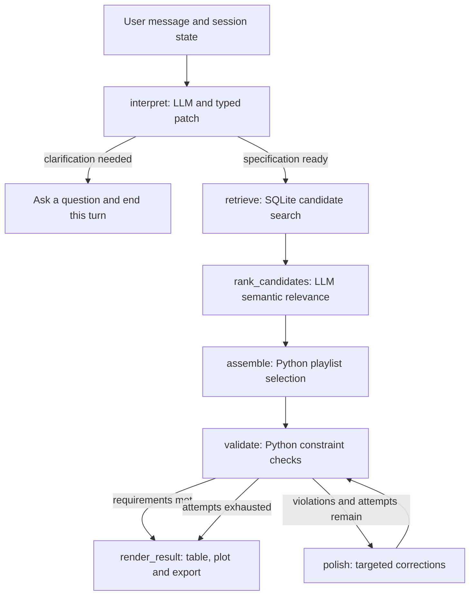

# Playlist Agent — MVP design

Date: 4 November 2026. Initial target: a three-hour local MVP using Gemini,
including data preparation, a small EDA notebook, implementation and verification.
Measure the local application before building the separate GCP deployment.
Status: application design; catalogue EDA has been executed and saved.

Development order: local Gemini MVP -> local performance/quality evaluation ->
cloud budget selection -> independent GCP application. Reuse a shared playlist
package; keep cloud quotas, storage and deployment outside the local application's
dependencies. See [readme.md](readme.md) and [cloud notes](docs/cloud-demo.md).

## 1. Goal

Build a small web app that creates and edits playlists from natural-language
requests, using real track metadata and executable checks.

Example: "50 minutes of electronic music for a walk. Start relaxed, make the
middle more energetic, and keep the final 10 minutes calm. No repeated artists."

## 2. MVP scope

- Create a playlist with duration, genre/artist preferences and up to three phases.
- Revise it in conversation: replace a phase, change intensity or preserve tracks.
- Show the ordered tracks, total duration, energy profile and validation results.
- Export CSV/JSON and links constructed from known Spotify IDs.
- Run mandatory constraint checks and a small catalogue EDA.
- Part two, outside the three-hour MVP: evaluate held-out playlist continuation
  after obtaining MPD files. This benchmark does not block completion of part one.

Spotify OAuth and playlist saving are the final implementation milestone, after
the core workflow and checks. Playback, audio extraction and model training are
later extensions. The first version uses one LLM and one agent workflow.

## 3. Data

**Main catalogue for the MVP:**
[Spotify Tracks Dataset](https://huggingface.co/datasets/maharshipandya/spotify-tracks-dataset),
pinned revision `635b034f69257814eff850a5c2b3346fe458134f`.
The executed readiness check found 114,000 rows, 89,741 distinct track IDs and
89,740 tracks with positive finite duration, valid energy, artist, title and genre.
There are 114 genre labels and 24,259 repeated-ID rows; merge genre labels rather
than treating repeated rows as distinct tracks. Artist credits use semicolons.
MPD is not needed to serve the app.

This is sufficient to demonstrate generation and editing but is not broad music
catalogue coverage. Check candidate counts after applying each request's filters.
For example, the union of `electronic`, `edm`, `house`, `techno`, `ambient` and
`chill` contains 5,230 distinct IDs before other filters. Narrow artist/genre
requests may have too few candidates. Expand the catalogue later using sources
with compatible durations and audio features.

The original candidate,
[Almost a million Spotify tracks](https://zenodo.org/records/11453410), was examined
in full with its published MD5 verified. It has 899,702 unique tracks, but 99.22%
lack duration and 88.89% lack artist names. Only 810 tracks have all fields needed
for the basic duration/energy/genre/artist demo. Keep its EDA as evidence for the
source change, rather than imputing durations or artist identities.

Prepare one local SQLite catalogue from the CSV. Retain:

`track_id, title, artists, genres, duration_ms, tempo, energy, valence,
danceability, instrumentalness, acousticness, explicit`.

Map source column names, deduplicate IDs, merge genre labels and normalise artist
names. Reject invalid durations; keep missing features as missing. Record valid
unique-track counts and feature coverage. Do not invent metadata with the LLM.
For the artist-repeat rule, count every credited artist using normalised names.

**Storage choice:** use SQLite for the MVP. Runtime work is indexed catalogue
filtering and returning a small candidate pool; selection/ranking runs in Python.
Use a `tracks` table and `track_genres(track_id, genre)` and
`track_artists(track_id, artist_norm)` association tables so genre and credited-
artist filters do not depend on substring matching. Add indexes for the actual
query paths. Pandas handles the small offline EDA. DuckDB would be a reasonable
choice for repeated whole-catalogue analytical scans, but this design does not
require them during app use. No performance comparison has been run: this is a
simplicity/workload decision, not a measured claim that SQLite is faster.
Use SQLite for the catalogue. Save conversation state as simple JSON snapshots
after completed turns; Gradio memory alone is temporary.

**Small EDA:** `notebooks/catalogue_eda.ipynb` examines the real CSV, records
source/checksum, row and distinct-ID counts, duplicates, missing/invalid values,
genre coverage and distributions of duration and audio features in the original
catalogue. It also checks completeness and deduplication of the replacement HF
catalogue. Inspect energy/tempo/valence relationships. Findings and provenance are
saved locally in the ignored `reports/eda_v2/` directory. Developer-only checks
and comparisons live in the ignored `tests/` directory. Keep data and temporary
files outside Git.

**Part-two evaluation data:** MPD reference playlists joined to the catalogue by
Spotify track ID. Use set intersection/hash join; no fuzzy name matching.
Acquire MPD files separately. AIcrowd's challenge page now states that the dataset
is no longer available for download and refers users to Spotify Research for
access: <https://www.aicrowd.com/challenges/spotify-million-playlist-dataset-challenge>.
An existing, legitimately obtained copy is therefore a prerequisite for this
later benchmark. No MPD acquisition work belongs to the three-hour MVP.

**Spotify API:** the core workflow uses the local catalogue and Spotify links.
At the end of implementation, add an adapter to create/fill a playlist when the
user explicitly requests export to their Spotify account. Current metadata
lookup and other personalization features can follow later.
Playlist creation requires user OAuth and suitable playlist modification scopes.
Use an authorization-page connection flow with a registered developer app and
callback (Authorization Code with PKCE), rather than asking for a user's token
file. Access/refresh tokens stay outside graph state and model prompts. Additional
later uses include search/metadata, accessible personal playlists and authorized
top/recently played items to seed preferences, subject to app mode and scopes.
New development-mode integrations require the app owner to have Premium and
limit authenticated users. Audio Features and Recommendations are unavailable
to new integrations under Spotify's published access changes, so the API is not
the source of energy/valence values for this design.
References: [quota modes](https://developer.spotify.com/documentation/web-api/concepts/quota-modes),
[API access changes](https://developer.spotify.com/blog/2024-11-27-changes-to-the-web-api),
[playlist creation](https://developer.spotify.com/documentation/web-api/reference/create-playlist).

## 4. Agent and tools

Stack: Python, LangGraph, Pydantic, SQLite, Gradio and a small LLM-provider adapter.
LangChain model/tool interfaces are optional, rather than an extra required layer.
Keep the model configurable through environment variables.

The LLM converts requests and follow-up edits into typed intent and a
`PlaylistSpec`/patch. The proposed field-level contract and worked example are in
[docs/request-contract.md](docs/request-contract.md). Interpret:

- create/edit intent and the affected phase/tracks;
- target duration and/or track count; a visible default tolerance of +/- 3 minutes;
- a semantic brief containing activity, mood and stylistic intent;
- preferred/allowed/excluded genres, reference/excluded/explicit-only artists;
- diversity preference and any explicit per-artist cap;
- up to three phases with duration, description and optional feature targets;
- explicit-content and vocal/instrumental preferences;
- references to retained/excluded tracks, resolved to catalogue IDs by code;
- assumptions, unverifiable requirements and any necessary clarification.

Ordinary style/reference requests are soft preferences. "Only" and explicit
exclusions/caps are hard constraints. Inferred energy/mood mappings are visible
proxies. Do not equate a subjective mood description with a verified audio fact.

Follow-up requests change an existing playlist, for example "make the middle
calmer" after initial creation. Interpret them as a typed patch to the current
specification; omitted fields retain their current values. Keep all unaffected
constraints. Distinguish omitted fields from explicit removal of a preference.
A locked track must remain present; locking does not promise an exact position.
A new request conflicting with a lock must produce an explicit conflict.

Ask a short clarification when essential information is missing or contradictory.
Show inferred preferences so the user can correct them. Energy/valence are proxies
for perceived mood; tempo is a separate axis.

| Tool | Responsibility |
| --- | --- |
| `search_tracks(spec)` | Filter the catalogue and return a bounded pool, initially up to 300 candidates per phase. |
| `rank_candidates(spec, shortlist)` | LLM ranks a diverse bounded shortlist for semantic fit from supplied metadata/features, returning candidate IDs and relative relevance scores. |
| `build_playlist(spec, candidates)` | Select/order whole tracks, fit duration and preserve locked tracks. |
| `validate_playlist(spec, ids)` | Check real IDs, duplicates, duration, genres, exclusions, artist limits and locked tracks; compute phase-profile deviations. |
| `plot_playlist_profile(spec, tracks)` | Return a reusable target-versus-actual energy plot using elapsed playback time and catalogue features. |

Part two adds `similar_tracks(seed_ids, k)` for continuation evaluation. Its input
tracks are seeds describing the current playlist, not examples used to update
LLM weights. The initial baseline ranks normalised audio-feature similarity and
excludes seed IDs.

Retrieve broadly under hard rules and balance the shortlist across artists before
LLM ranking (initially about 20-30 candidates per phase). Reference artists guide
similarity rather than imply an artist-only filter. Assemble using semantic
relevance, feature fit, smooth transitions and a soft artist-repeat penalty.
Explicit user caps remain hard. Refill/expand candidate pools before reporting
shortage; relaxing a soft preference cannot silently change a hard rule.
Start with greedy selection and a small local replacement pass. Prefer candidates
near each phase's target energy and avoid abrupt feature jumps. Evaluate phases
on elapsed playback time, not equal track counts. Tracks can straddle boundaries;
do not trim audio. Hard rules take priority over profile preferences.

Graph (part one):



Here, polish means an automatic correction after a failed check, not a user edit.
For example, if the allowed duration is 47-53 minutes but the result is 55 minutes,
replace an unlocked track with a shorter eligible one and validate again. Use
deterministic replacements/rebuilding first; another LLM call is not required.
The polish node reuses search/build functions as necessary and then returns to
validation, adjusting the playlist using actual violations. It cannot relax
hard user rules silently. If attempts fail, show the unmet requirements and offer
a specific relaxation; do not claim mathematical infeasibility from a failed search.

**How LangGraph fits:** `StateGraph` connects ordinary Python functions (nodes)
that receive shared state and return partial updates. Edges select the next
function. Conditional edges route based on clarification status, validation
results and the polish attempt count. The normal path has two LLM calls:
`interpret` and `rank_candidates`. Retrieval, constrained assembly, validation,
polish and plotting run as code. Polish reuses scored candidates first; pool
expansion can trigger a further bounded ranking call within the attempt budget.
Model/API failures become visible errors rather than successful empty results.

The shared state contains the current message/conversation, parsed intent,
current specification, previous and working playlist IDs, candidate IDs,
validation report, clarification question and `polish_attempts`. Locked IDs live
in the authoritative specification. Gradio supplies the active conversation ID.
A JSON snapshot stores the current spec, accepted playlist, messages and pending
question after each completed turn. Include a schema version; write a temporary
file alongside the snapshot and replace it, with one writer per conversation.
The UI retains that ID or allows saved conversations to be reopened. This restores
completed turns; a checkpointer can later support mid-graph recovery. A new message resets transient
candidates, validation and the polish counter while preserving the current spec
and playlist. A clarification ends this invocation; the reply starts another
with the saved context. Credentials are excluded from snapshots and prompts.

`interpret` sends only the current request, relevant context/current spec and
supported vocabulary to the LLM. It parses a create request or an edit patch,
applies the patch in code, and validates the resulting specification with
Pydantic and cross-field checks. `retrieve` runs parameterised SQL.
`rank_candidates` evaluates semantic fit to the request using supplied catalogue
metadata/features. Its judgments are approximate and cannot verify unobserved
lyrics/audio. `assemble` selects/orders real IDs under the constraints.
`validate` checks the actual selected tracks.
`render_result` builds the UI from computed facts and calls the reusable
`plot_playlist_profile` function. If a hard rule still fails after two polish
attempts, the UI marks the result as failing and offers a specific next action.
Only a validated result replaces the active playlist; a failed attempt retains
the previously accepted playlist and exposes its own validation report.

Example: a 50-minute request creates phase targets of 10/30/10 minutes. Energy
targets inferred from "calm/energetic/calm" are shown to the user. A later request
to lower the middle phase changes that phase's target through a patch, keeps
other constraints/locks, rebuilds the affected selection and validates the whole
playlist. The same graph handles both turns.

## 5. UI

One Gradio page: chat, a few example prompts, playlist table, total duration,
energy-over-time plot, check results and export button. Track IDs can be locked
through a simple selection control. Display tool actions/results, not private
model reasoning. Explanations must agree with computed facts.

Show the interpreted specification before/alongside the result: target duration,
phase targets, exclusions and artist limits. After a user-requested playlist
change, show how many tracks were added/removed, which locks were preserved and
the change in duration. Plot elapsed playback minutes on the x-axis and energy
on the y-axis: target phase energy plus the actual per-track feature values.
The plot uses catalogue features; it does not imply audio playback or analysis.

Demo cases: create the walk playlist; lower the middle phase's energy; replace
the ending while retaining two locked tracks. Focus/party requests can reuse the
same controls. Unsupported attributes produce a clarification or limitation.

## 6. Mandatory sanity evaluation

**Constraint checks:** 10 fixed requests/edits covering phases, duration, exclusions,
artist limits, locked tracks, contradictory requests and empty candidate pools.
Report valid-ID rate, duplicate count, hard-rule pass rate, duration error and
phase-profile deviation. Failed requests must be visible as failures.

**Part two: recommendation checks (outside the MVP):** freeze the usable catalogue, then select 20 MPD
playlists containing at least 10 catalogue tracks. Record coverage and evaluate
their catalogue-covered tracks. Reveal 5 seeds, hide the rest and request K=20
new tracks. Use deterministic splits and save playlist/seed/target IDs.
Deduplicate each reference playlist by track ID, preserve its order and use the
first five catalogue-covered tracks as seeds. The remaining covered tracks are
the hidden targets. Report the original-to-covered track ratio: this benchmark
is conditional on catalogue coverage and does not represent all of MPD.
Run these requests through the same agent with seeds and K, without inventing a
duration or energy profile; it calls `similar_tracks` and validates the result.

- Precision@20 = hidden-track hits / 20.
- Recall@20 = hidden-track hits / number of hidden targets.
- Average over playlists; report short outputs, latency and LLM/tool calls.

Compare feature-similarity retrieval with a fixed-seed random baseline using the
same full usable candidate universe, excluding seeds. If a popularity baseline
is added, derive its scores only from non-test playlists or independent metadata.
Example: 2 hidden hits among 20 recommendations with 10 hidden targets gives
Precision@20 = 0.10 and Recall@20 = 0.20. A non-hit is an unobserved choice, not
proof that the user would dislike the song. This evaluation tests continuation,
not the free-form duration/energy request or the correctness of request parsing.

Exclude complete test-playlist memberships from retrieval indexes, co-occurrence
statistics and future training. Track metadata may remain in the catalogue.
Reuse this exact split, candidate universe and K for the later recsys comparison.
Do not add artist-repeat rules to continuation tests unless they are part of the
test specification. These metrics measure recovery of observed choices; listening
quality and the free-form mood scenario need separate checks.

## 7. Delivery and completion

Build in this order: catalogue preparation -> tools and checks -> graph -> UI ->
evaluation and README. Keep raw data outside Git; save preparation steps and source
references. A compact project layout is enough:

```text
app.py                 # Gradio UI
agent.py               # State, structured request and graph
tools.py               # Catalogue queries, selection and validation
prepare_data.py        # Feature CSV import and catalogue normalisation
evaluate.py            # Constraint sanity metrics; continuation added in part two
notebooks/catalogue_eda.ipynb  # Catalogue exploration
reports/               # Local findings and evaluation outputs; ignored
tests/                 # Local developer checks; ignored
README.md
```

Suggested budget: 0-25 minutes for data and small EDA; 25-65 for tools and checks;
65-95 for the LLM/state graph; 95-130 for UI; 130-160 for evaluation/fixes;
160-180 for the final demo and README. Download data while preparing code.
If setup runs over budget, record the scope reduction explicitly.

HF Jobs may run catalogue preparation or evaluation as a CPU batch job if access
is already configured. Save reports/artifacts outside the ephemeral job and set
an explicit timeout. Keep a local execution path so remote setup cannot block
the demo. No training or GPU job is required for this design.

The application demo is done when the primary request works end to end,
follow-up edits preserve remaining constraints, polish terminates, exports
reference real tracks, and the EDA and constraint reports contain actual results.
The separate part-two recommendation evaluation is done only when its report
contains actual held-out results; MPD acquisition remains part of that later work.
Include a short demo and known limitations. No multi-agent framework or custom
frontend is needed for this MVP.
